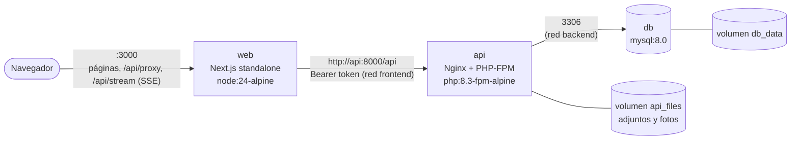
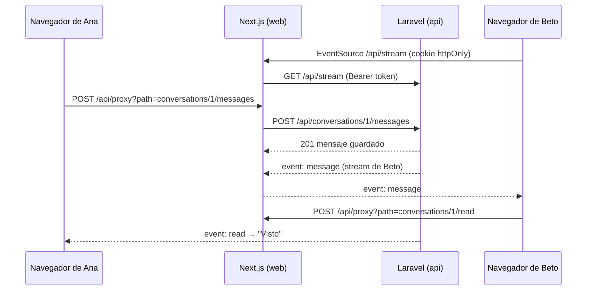

# Chat Ecosystem: chat en tiempo real con Next.js, Laravel y Docker

[](https://github.com/alejandrocamposd17-beep/chat-ecosystem-docker/actions/workflows/ci.yml)

**Autor:** Alejandro Campos

Aplicación de chat con cuentas de usuario y mensajes en tiempo real, empaquetada como un ecosistema de producción de tres servicios orquestados con Docker Compose:

| Servicio | Tecnología | Imagen base |
|---|---|---|
| **web** (Frontend) | Next.js 16.4 (App Router), React 19, Tailwind CSS 4 | `node:24-alpine` |
| **api** (Backend) | Laravel 13, PHP 8.3, PHP-FPM + Nginx | `php:8.3-fpm-alpine` |
| **db** (Base de datos) | MySQL 8.0 | `mysql:8.0` |

Cada imagen se construye con **builds multi-stage** para separar la fase de construcción de la de ejecución, reducir el tamaño final, minimizar la superficie de ataque y aprovechar la caché de capas de Docker. Todo el ecosistema se levanta con un solo comando: `docker compose up`.

---

## Funcionalidades

- **Cuentas de usuario**: registro e inicio de sesión. La API emite un token opaco (en la base solo se guarda su hash SHA-256) y Next.js lo guarda en una **cookie httpOnly**: el JavaScript del navegador nunca lo ve.
- **Chats 1 a 1 y grupos**: busca a otra persona e inicia un chat, o crea un grupo (hasta 50 integrantes). El administrador del grupo puede renombrarlo, agregar y quitar integrantes; cualquiera puede salirse. Los cambios aparecen como mensajes del sistema.
- **Tiempo real con Server-Sent Events**: los mensajes llegan al instante, con indicador de **"escribiendo..."** (en grupos, con el nombre de quién escribe), confirmación de **"Visto"** y contador de **no leídos**.
- **Presencia en vivo**: "En línea" o "Visto por última vez hoy a las 10:30", actualizado sin recargar.
- **Imágenes y archivos adjuntos**: fotos que se ven dentro del chat y documentos (PDF, Word, Excel, ZIP, TXT) de hasta 5 MB.
- **Responder, editar y eliminar mensajes**: responde citando un mensaje (clic en la cita para saltar al original), corrige tus mensajes (se marcan como "editado") o elimínalos ("Mensaje eliminado").
- **Reacciones con emoji**: 👍 ❤️ 😂 😮 😢 🙏, sincronizadas en tiempo real.
- **Búsqueda dentro de la conversación**: por texto o nombre de archivo, con salto al mensaje encontrado.
- **Notificaciones del navegador** cuando llega un mensaje y la pestaña no está a la vista, y contador de no leídos en el título de la pestaña: `(3) Chat en tiempo real`.
- **Perfil de usuario**: cambiar nombre, foto de perfil y contraseña (al cambiarla se cierran las demás sesiones).
- **Historial paginado**: los mensajes se cargan de 50 en 50 ("Cargar mensajes anteriores").
- **Interfaz adaptable**: en celular se ve la lista o el chat, con botón para volver y un menú ⋯ para las acciones de cada mensaje.
- **Pruebas y CI**: PHPUnit para la API, pruebas de punta a punta con Playwright (dos navegadores conversando a la vez) y GitHub Actions que valida backend, frontend y el ecosistema Docker completo.

### Cuentas de demostración

El seeder crea cinco usuarios con la contraseña `password`: `alejandro@chat.test`, `andrea@chat.test`, `carlos@chat.test`, `sofia@chat.test` y `diego@chat.test`, además del grupo *Equipo Docker*. Para ver el tiempo real, abre dos navegadores (o una ventana privada) y entra con una cuenta distinta en cada uno.

---

## Arquitectura de contenedores



**Flujo de un mensaje en tiempo real:**



- **Red `frontend`**: conecta `web` con `api`.
- **Red `backend`**: conecta `api` con `db`. El contenedor `web` no está en esta red, por lo que no puede alcanzar la base de datos.
- **MySQL no publica el puerto 3306 al host**: solo es accesible desde la API.
- **Orden de arranque**: `db` (healthy) -> `api` (healthy) -> `web`. Compose espera a que cada servicio pase su healthcheck, no solo a que el contenedor inicie.
- **El navegador solo habla con Next.js** (patrón *Backend for Frontend*): los Server Components y los Route Handlers (`/api/session`, `/api/proxy`, `/api/stream`) llaman a Laravel por `API_INTERNAL_URL` (`http://api:8000/api`, DNS interno de Docker) agregando el token de la cookie. La API sigue publicada en `:8000` para pruebas directas.

## Estructura del repositorio

```
.
├── docker-compose.yml
├── .env.example
├── compare-images.sh               # Comparación básica vs multi-stage
├── README.md
├── image-comparison.md             # Resultados de compare-images.sh
├── frontend/                       # Next.js (App Router)
│   ├── Dockerfile
│   ├── Dockerfile.basic            # Versión "antes", solo para comparar
│   ├── .dockerignore
│   ├── next.config.ts              # output: "standalone"
│   └── src/
│       ├── app/                    # login, /chat/[id], /profile y Route Handlers del BFF
│       ├── components/             # lista de chats, ventana de chat, burbujas, grupos, perfil
│       ├── lib/api.ts              # cliente de la API (URL interna vs pública)
│       └── types/chat.ts           # modelos User, Message, Conversation
├── backend/                        # Laravel 13 (API REST)
│   ├── Dockerfile
│   ├── Dockerfile.basic            # Versión "antes", solo para comparar
│   ├── .dockerignore
│   ├── docker/
│   │   ├── entrypoint.sh
│   │   ├── nginx/default.conf
│   │   └── php/zz-production.ini
│   ├── app/Http/Controllers/Api/   # Auth, Conversation, Participant, Message, Reaction, Profile, Stream
│   ├── app/Http/Resources/         # JSON con la misma forma que los tipos TS
│   ├── app/Models/                 # User, Conversation, Message, MessageReaction
│   ├── database/migrations/
│   ├── database/seeders/
│   └── routes/api.php
├── e2e/                            # Pruebas de punta a punta con Playwright
└── database/
    └── init/01-charset.sh          # Script de inicialización de MySQL
```

## Endpoints de la API

Todas las rutas, excepto registro e inicio de sesión, requieren `Authorization: Bearer <token>`. Las conversaciones ajenas responden 404 (no se revela que existen).

| Método | Ruta | Respuesta |
|---|---|---|
| POST | `/api/auth/register` | `{ user, token }` (201). Límite: 10 por minuto por IP |
| POST | `/api/auth/login` | `{ user, token }`. Límite: 10 intentos por minuto por cuenta e IP |
| POST | `/api/auth/logout` | Revoca solo el token usado |
| GET / PATCH | `/api/me` | `User` autenticado / cambia el nombre |
| POST / DELETE | `/api/me/avatar` | Sube (JPG, PNG o WebP, máx. 2 MB) o quita la foto de perfil |
| PUT | `/api/me/password` | Cambia la contraseña (pide la actual) y revoca las demás sesiones |
| GET | `/api/users/{id}/avatar` | Foto de perfil |
| GET | `/api/users?search=` | Personas con las que se puede iniciar un chat |
| GET | `/api/conversations` | `Conversation[]` del usuario (chats y grupos), con `unreadCount` y `readStates` |
| POST | `/api/conversations` | `{ "userId": 2 }` abre o reutiliza un chat; `{ "name": "...", "userIds": [2, 3] }` crea un grupo |
| GET / PATCH | `/api/conversations/{id}` | `Conversation` / renombra el grupo (solo administrador) |
| POST | `/api/conversations/{id}/participants` | Agrega un integrante (solo administrador) |
| DELETE | `/api/conversations/{id}/participants/{userId}` | Quita a un integrante (administrador) o sale del grupo (uno mismo) |
| GET | `/api/conversations/{id}/messages?before=&search=` | `Message[]` de 50 en 50, o resultados de búsqueda |
| POST | `/api/conversations/{id}/messages` | `Message` creado (201), JSON o multipart con `attachment` y `replyToId`. Límite: 30 por minuto, 10 archivos por minuto |
| PATCH / DELETE | `/api/conversations/{id}/messages/{messageId}` | Edita o elimina un mensaje propio |
| POST | `/api/conversations/{id}/messages/{messageId}/reactions` | Pone o quita una reacción `{ "emoji": "👍" }` |
| GET | `/api/attachments/{messageId}` | Descarga el adjunto (solo integrantes de la conversación) |
| POST | `/api/conversations/{id}/read` | Marca la conversación como leída |
| POST | `/api/conversations/{id}/typing` | Avisa "escribiendo..." durante 5 segundos |
| GET | `/api/stream` | Server-Sent Events: `message`, `message_updated`, `typing`, `read`, `presence` y `conversations` |
| GET | `/up` | Healthcheck de Laravel |

Los API Resources devuelven exactamente las claves de las interfaces TypeScript del frontend (`avatarUrl`, `chatId`, `isSelf`, etc.), con IDs como `string` y fechas en ISO 8601.

## Requisitos

- Docker Engine 24+ con Docker Compose v2 (BuildKit activo por defecto)

## Cómo ejecutar

1. Clonar el repositorio:
   ```bash
   git clone https://github.com/alejandrocamposd17-beep/chat-ecosystem-docker.git
   cd chat-ecosystem-docker
   ```
2. Crear el archivo de variables y cambiar las contraseñas:
   ```bash
   cp .env.example .env
   ```
3. Generar la llave de Laravel y pegarla en `APP_KEY` dentro de `.env`:
   ```bash
   docker compose run --rm --no-deps --entrypoint php api artisan key:generate --show
   ```
4. Construir y levantar todo el ecosistema:
   ```bash
   docker compose up -d --build
   ```
5. Verificar:
   ```bash
   docker compose ps
   ```
   - Frontend: http://localhost:3000 (inicia sesión con una cuenta de demostración)
   - Healthcheck de la API: http://localhost:8000/up

Al primer arranque la API ejecuta las migraciones y carga usuarios y conversaciones de ejemplo (el seeder solo inserta datos si la base está vacía). Si ya tenías un volumen de una versión anterior, ejecuta `docker compose down -v` para recrear los datos con las cuentas de demostración.

Para detener: `docker compose down` (los datos se conservan en el volumen). Para borrar también los datos: `docker compose down -v`.

### Fijar dependencias de PHP (`composer.lock`)

Para builds 100% reproducibles, `composer.lock` debe estar versionado. Si el repositorio aún no lo tiene, se genera sin instalar PHP localmente:

```bash
docker run --rm -v "$PWD/backend":/app composer:2 update --no-install --no-scripts
git add backend/composer.lock
```

El `composer.json` fija `config.platform.php = 8.3.0`, así que Composer resuelve versiones compatibles con la imagen de producción aunque se ejecute con otra versión de PHP. El Dockerfile funciona con o sin lockfile, pero con lockfile cada build instala exactamente las mismas versiones.

## Variables de entorno

| Variable | Servicio | Descripción |
|---|---|---|
| `MYSQL_ROOT_PASSWORD` | db | Contraseña de root, solo para administración |
| `MYSQL_DATABASE` | db, api | Base de datos creada al primer arranque |
| `MYSQL_USER` / `MYSQL_PASSWORD` | db, api | Usuario con el que se conecta Laravel (nunca root) |
| `APP_KEY` | api | Llave de cifrado de Laravel |
| `API_PUBLIC_URL` | api | URL pública de la API |
| `FRONTEND_URL` | api | Origen(es) permitido(s) para CORS |
| `RUN_MIGRATIONS` | api | Ejecuta `migrate --force` al iniciar |
| `SEED_DATABASE` | api | Carga datos de ejemplo si la base está vacía |
| `CHAT_TOKEN_TTL_DAYS` | api | Días de vigencia de los tokens de sesión (30 por defecto) |
| `API_INTERNAL_URL` | web | URL de la API desde Next.js (en Compose: `http://api:8000/api`) |
| `API_PORT` / `WEB_PORT` | host | Puertos publicados en el host |

## Decisiones técnicas

### Frontend (Next.js)

- **Tres etapas (`deps`, `builder`, `runner`)**: las dependencias se instalan en una etapa aislada copiando solo `package.json` y el lockfile. Mientras estos no cambien, Docker reutiliza la capa y el build se salta la instalación.
- **`output: "standalone"`**: Next.js genera un `server.js` mínimo y copia solo los módulos que la app realmente usa. La imagen final no contiene `node_modules` completos, devDependencies ni código fuente. `node server.js` es el equivalente optimizado de `next start` para contenedores.
- **`node:24-alpine` en lugar de `node:20-alpine`**: Node 20 llegó a fin de soporte en abril de 2026 y ya no recibe parches de seguridad. Node 24 es la versión LTS activa y cumple el requisito de Next.js 16 (Node 20.9+). Alpine mantiene la imagen base pequeña.
- **Backend for Frontend con cookie httpOnly**: el token de la API nunca llega al JavaScript del navegador (protege ante XSS). Los Route Handlers que cambian datos verifican el encabezado `Origin` y la cookie es `SameSite=Lax` (protección CSRF). `src/proxy.ts` redirige al login si no hay sesión. Como no hay variables `NEXT_PUBLIC_*`, la misma imagen sirve para cualquier entorno.
- **Tiempo real con `EventSource`**: una sola conexión SSE para toda la app (`RealtimeProvider`) reparte los eventos a la lista de chats y a la ventana abierta. Al reconectar, el navegador envía `Last-Event-ID` y no se pierden mensajes.
- **Build independiente de la API**: con Cache Components (activo por defecto en Next.js 16.4), los datos sin caché se cargan dentro de `<Suspense>`. Next.js prerenderiza el "shell" estático y transmite los datos en cada petición, por lo que `next build` no necesita que la API esté levantada.
- **Fuentes del sistema en lugar de Google Fonts**: el build no depende de descargar fuentes de internet, lo que lo hace más rápido y reproducible.
- **Sin npm, npx, corepack ni yarn en la imagen final**: el servidor standalone solo necesita `node`. Estas herramientas venían en la imagen base y traían vulnerabilidades altas en sus dependencias internas, así que se eliminan en la etapa runner.
- **Usuario sin privilegios (`nextjs`, UID 1001)**: el proceso no corre como root. `public/` queda como solo lectura y solo `.next` es escribible (caché de ISR).
- **Caché de npm con BuildKit (`--mount=type=cache`)**: acelera reinstalaciones sin guardar la caché dentro de la imagen.
- **`.dockerignore`**: excluye `node_modules`, `.next`, `.git` y `.env`, lo que reduce el contexto de build y evita filtrar secretos.
- **`HEALTHCHECK`** y **telemetría desactivada**.

### Backend (Laravel)

- **PHP 8.3 en lugar de 8.2**: Laravel 13 (versión vigente) requiere PHP 8.3 como mínimo. Se usa `php:8.3-fpm-alpine`, que cumple el requisito de "PHP 8.2+" de la arquitectura.
- **Etapa `vendor` con la misma versión de PHP que producción**: se usa `php:8.3-cli-alpine` con el binario de Composer copiado desde `composer:2`. Así Composer valida dependencias contra el mismo PHP que corre en producción. Composer, git y unzip existen solo en esta etapa; a la imagen final se copia **únicamente la carpeta `vendor/`**.
- **`composer install` antes de copiar el código**: la capa de dependencias queda en caché mientras `composer.lock` no cambie. Se usa `--no-dev` (sin PHPUnit, Faker ni herramientas de desarrollo) y autoload optimizado.
- **Extensiones**: la imagen oficial ya incluye `mbstring`, `openssl`, `tokenizer`, `xml`, `ctype` y `json`. Solo se compilan `pdo_mysql` y `opcache`. Las herramientas de compilación se instalan y eliminan en la misma capa para que no aumenten el tamaño. Un paso del build verifica que las siete extensiones requeridas estén presentes y falla si alguna falta.
- **`apk upgrade` en la etapa runtime**: aplica los parches de seguridad de Alpine disponibles al momento del build. Eliminó una vulnerabilidad crítica (`brotli`) heredada de la imagen base.
- **Nginx + PHP-FPM en el mismo contenedor**: Nginx atiende el puerto 8000 y pasa las peticiones PHP a PHP-FPM por `127.0.0.1:9000`, que nunca se expone. Así el ecosistema se mantiene en tres servicios. La alternativa (Nginx en un contenedor separado) escala mejor de forma independiente, pero requiere compartir `public/` entre contenedores.
- **OPcache con `validate_timestamps=0`**: el código no cambia dentro de un contenedor, así que PHP no revisa archivos en cada petición.
- **Autenticación sin dependencias extra**: guard propio con `Auth::viaRequest`. Los tokens son aleatorios de 64 caracteres, se guardan como hash SHA-256, vencen a los 30 días y `logout` revoca solo el de la sesión actual. El login responde el mismo error si el correo no existe o la contraseña es incorrecta.
- **Server-Sent Events en lugar de WebSockets**: el stream (`/api/stream`) usa HTTP normal, así funciona detrás de Nginx y de cualquier proxy sin un servidor extra. Cada conexión dura 25 segundos y el navegador se reconecta solo; Nginx tiene `fastcgi_buffering off` en esa ruta y PHP-FPM sube a 20 procesos porque cada conexión abierta ocupa uno.
- **Seguridad**: `php.ini-production`, `expose_php=Off`, `server_tokens off`, bloqueo de archivos ocultos en Nginx, CORS restringido al origen del frontend, rate limit en login, registro, mensajes, archivos, reacciones y avisos de escritura, workers de PHP-FPM como `www-data` y solo `storage/` y `bootstrap/cache/` con permisos de escritura. El `.env` nunca entra a la imagen: la configuración llega por variables de entorno.
- **Archivos adjuntos privados**: se guardan fuera de `public/` (disco `local`, volumen `api_files`) y solo se descargan a través de la API, que verifica que quien los pide sea integrante de la conversación; el navegador los recibe por el BFF de Next.js con la cookie httpOnly. El tipo se valida por el contenido real del archivo y no por la extensión (un `.exe` renombrado a `.png` se rechaza); SVG y HTML no se aceptan porque pueden ejecutar scripts. Se descargan con `X-Content-Type-Options: nosniff` y `Content-Security-Policy: sandbox`, y solo las imágenes se muestran en línea; el resto se fuerza como descarga. El nombre original se limpia antes de guardarlo y el archivo se guarda con un nombre aleatorio.
- **Permisos por autor y por rol**: solo el autor edita o borra su mensaje (al borrarlo se eliminan también el archivo y las reacciones); solo el administrador renombra el grupo o quita integrantes. Si el administrador sale, el integrante más antiguo toma su lugar.
- **Cachés de configuración, rutas y eventos en runtime** (`config:cache`, `route:cache`, `event:cache`): se generan al arrancar, porque las variables de entorno llegan desde Compose y no existen durante el build. No se usa `optimize` porque también compila vistas y la API no tiene vistas Blade.
- **Seeder sin Faker**: Faker es dependencia de desarrollo y no existe en la imagen de producción, por eso los datos de ejemplo están definidos explícitamente. El seeder es idempotente.
- **Logs a `stderr`**: visibles con `docker compose logs api`.

### Base de datos (MySQL)

- **Imagen oficial `mysql:8.0`** configurada solo con variables de entorno.
- **Volumen nombrado `db_data`** en `/var/lib/mysql`: los datos sobreviven a `docker compose down` y a la recreación de contenedores.
- **Script de inicialización** en `/docker-entrypoint-initdb.d/` (montado como solo lectura): se ejecuta solo la primera vez que se crea el volumen y asegura `utf8mb4` para soportar emojis y acentos en los mensajes. El esquema lo crean las migraciones de Laravel.
- **Sin puerto publicado** y en una red a la que el frontend no tiene acceso.
- **Healthcheck con `mysqladmin ping`**: la API no arranca hasta que MySQL acepta conexiones.

## Validaciones y resultados

Validaciones realizadas durante el desarrollo:

- `next build` con `output: "standalone"` compila sin la API levantada.
- El servidor standalone (`node server.js`) se probó contra una API con la misma forma de respuestas: renderiza la lista de chats, la conversación y el estado de error.
- TypeScript y ESLint sin errores; sintaxis de todos los archivos PHP validada con `php -l`.
- El ecosistema completo se levantó con `docker compose up`: los tres servicios quedaron `healthy` y se verificó el flujo navegador -> API -> MySQL enviando un mensaje desde el chat (hoy lo verifica el CI en cada cambio, ver Evidencias).

| Medición | Tamaño |
|---|---|
| `node_modules` completo del frontend | 489 MB |
| Build standalone que entra a la imagen final | 50 MB |

### Comparación: imágenes básicas vs multi-stage

Para medir el impacto de la optimización, el repositorio incluye las versiones "antes" de cada imagen:

- `frontend/Dockerfile.basic` y `backend/Dockerfile.basic`: representan el enfoque inicial (una sola etapa, imágenes Debian completas, `COPY . .` antes de instalar dependencias, dependencias de desarrollo incluidas, ejecución como root y servidores de desarrollo). **Solo existen para la comparación, no se usan en producción.**
- `compare-images.sh`: construye las cuatro imágenes y mide tamaño, número de capas, tiempo de build en frío y tiempo de rebuild después de un cambio en el código.

```bash
./compare-images.sh
```

El script imprime la tabla y la guarda en `image-comparison.md`. Ambas versiones usan el mismo `.dockerignore`, así que las diferencias se deben únicamente al diseño de cada Dockerfile.

**Qué demuestra cada columna:**

- **Tamaño**: efecto de Alpine, del build standalone de Next.js, de excluir dependencias de desarrollo y de eliminar herramientas de compilación.
- **Capas**: cuántas capas genera cada Dockerfile. Agrupar comandos en un solo `RUN` reduce capas, aunque separar los archivos de configuración puede agregar algunas pequeñas (ver análisis).
- **Rebuild tras cambio de código**: efecto del orden de las capas. En las imágenes básicas, `COPY . .` va antes de instalar dependencias, por lo que cualquier cambio en el código obliga a reinstalar todo. En las multi-stage, la capa de dependencias se reutiliza desde la caché.

| Imagen | Tag | Tamaño | Capas | Build en frío | Rebuild tras cambio de código |
|---|---|---|---|---|---|
| Frontend basico | `chat-web:basic` | 2907 MB | 12 | 80s | 65s |
| Frontend multi-stage | `chat-web:1.0` | 326 MB | 9 | 48s | 15s |
| Backend basico | `chat-api:basic` | 938 MB | 19 | 32s | 13s |
| Backend multi-stage | `chat-api:1.0` | 185 MB | 23 | 55s | 8s |

_Medido el 2026-10-24 con Docker version 29.9.2, build a82e528._

**Análisis de resultados:**

- **Frontend: 2907 MB -> 326 MB (89% menos).** Se debe a usar Alpine y a copiar solo el build standalone de Next.js, en lugar de los `node_modules` completos y el código fuente.
- **Backend: 938 MB -> 185 MB (80% menos).** Se debe a usar Alpine y a dejar fuera de la imagen final las dependencias de desarrollo, Composer y las herramientas de compilación.
- **Rebuild tras un cambio de código: frontend 65s -> 15s (77% más rápido) y backend 13s -> 8s (38% más rápido).** En las imágenes básicas, `COPY . .` va antes de instalar dependencias, así que cualquier cambio obliga a reinstalar todo. En las multi-stage, la capa de dependencias se reutiliza desde la caché.
- **El build en frío del backend multi-stage es más lento (55s vs 32s).** Es un costo esperado: aplica los parches de seguridad de Alpine, compila `pdo_mysql` y `opcache` desde código fuente y ejecuta dos etapas. Se paga una sola vez; en el trabajo diario lo que cuenta es el rebuild.
- **El backend multi-stage tiene más capas (23 vs 19).** Cada archivo de configuración (php.ini, Nginx, entrypoint) se copia en su propia capa pequeña, después de la instalación de extensiones, para que un cambio de configuración no obligue a recompilarlas. Más capas no implica más peso: la imagen final pesa 80% menos.

### Análisis de seguridad (Docker Scout)

Escaneo de las cuatro imágenes con `docker scout quickview`:

| Imagen | Paquetes | Críticas | Altas | Medias | Bajas | Usuario por defecto |
|---|---|---|---|---|---|---|
| chat-web:basic | 1204 | 3 | 56 | 85 | 245 | root |
| chat-web:1.0 | 96 | 0 | 0 | 0 | 0 | nextjs (sin privilegios) |
| chat-api:basic | 397 | 0 | 3 | 6 | 150 | root |
| chat-api:1.0 | 142 | 0 | 2 | 8 | 5 | root (workers como www-data y nginx) |

- **Frontend: de 389 vulnerabilidades a 0** y de 1204 a 96 paquetes. Un primer escaneo encontró 4 vulnerabilidades altas en dependencias internas de npm (`brace-expansion` y `undici`). Como el servidor standalone solo necesita `node`, se eliminaron npm, npx, corepack y yarn en lugar de actualizarlos.
- **Eliminar npm no redujo el tamaño de la imagen (326 MB)**: esos archivos pertenecen a las capas de la imagen base. Borrarlos en una capa posterior los quita del sistema de archivos final, que es lo que importa para la seguridad, pero no de las capas anteriores.
- **Backend: de 159 vulnerabilidades a 15 (91% menos)** y de 397 a 142 paquetes. Un primer escaneo encontró 1 crítica (`brotli`) y 1 alta (`curl`) heredadas de `php:8.3-fpm-alpine`. Con `apk upgrade` se eliminó la crítica. Queda 1 alta con parche reportado por Scout que `apk upgrade` no resolvió al momento del build; se corrige reconstruyendo con `docker compose build --pull --no-cache api` cuando la versión corregida llegue a los repositorios de Alpine o a la imagen base.
- **Las capas propias de los Dockerfiles no agregan vulnerabilidades**: todas las restantes vienen de las imágenes oficiales de Node.js y PHP.

## Pruebas y CI

```bash
cd backend && composer install && php artisan test   # requiere PHP 8.3 y Composer
```

- **Pruebas de la API (PHPUnit, SQLite en memoria)**: registro, login, tokens con hash y vencidos, logout, límites de velocidad, chats entre usuarios, acceso a conversaciones ajenas (404), no leídos y lecturas, paginación, búsqueda de usuarios y de mensajes, grupos y permisos de administrador, adjuntos (tipos permitidos, archivos disfrazados, descarga solo para integrantes), edición y borrado solo por el autor, reacciones, respuestas, perfil y contraseña, stream SSE (mensajes, ediciones, reacciones, "escribiendo..." y aislamiento entre usuarios) y las cuentas del seeder.
- **Pruebas de punta a punta (Playwright, `e2e/`)**: dos navegadores con sesiones distintas (Alejandro y Andrea) contra el ecosistema levantado con Docker: "escribiendo...", mensaje en tiempo real, "Visto", reacción, envío de una imagen y mensajes de grupo.
- **GitHub Actions** en cada push y PR:
  - **API**: pruebas con PHPUnit y estilo con Laravel Pint.
  - **Frontend**: ESLint, verificación de tipos con TypeScript y `next build`.
  - **Ecosistema Docker**: construye las imágenes, levanta los tres servicios con `docker compose up`, espera a que estén `healthy` y prueba el flujo real (login a través de Next.js y lista de chats) y después corre las pruebas de Playwright contra esos contenedores.

## Demo en Render

`render.yaml` publica dos servicios gratuitos en Render (API y frontend). La demo usa SQLite dentro del contenedor de la API, así que los datos vuelven a los de ejemplo en cada reinicio.

1. En Render: **New → Blueprint** y elige este repositorio.
2. Render crea `chat-ecosystem-api-alejandro` y `chat-ecosystem-web-alejandro`. Abre la URL del servicio web e inicia sesión con una cuenta de demostración.
3. Si Render asignó otra URL a la API, actualiza `API_INTERNAL_URL` del servicio web con `https://<url-de-la-api>/api`.

En el plan gratuito los servicios se suspenden tras 15 minutos sin uso: la primera visita tarda cerca de un minuto en despertar.

## Limitaciones conocidas

- **SSE ocupa un proceso de PHP-FPM por conexión abierta**: con 20 procesos alcanza para una demo o un equipo pequeño. Para muchos usuarios simultáneos convendría un servidor de WebSockets (por ejemplo, Laravel Reverb) o un runtime asíncrono.
- **Server-Sent Events en lugar de WebSockets**: SSE cubre todo lo que necesita el chat (el servidor empuja eventos y el navegador envía por HTTP normal) sin otro servicio que mantener. Migrar a Laravel Reverb implicaría un cuarto contenedor (servidor de WebSockets) y nuevas dependencias de PHP y npm; tiene sentido cuando haya muchos usuarios simultáneos.
- **Archivos en disco local**: los adjuntos y fotos se guardan en el volumen `api_files`. En Render (plan gratuito) se borran en cada reinicio; en producción real convendría un almacenamiento de objetos como S3.
- **Notificaciones solo con la pestaña abierta**: usan la API `Notification` del navegador, no Web Push, así que no llegan si el chat está cerrado.
- **Procesos maestros como root en la API**: los workers de PHP-FPM y Nginx corren como `www-data` y `nginx`, pero sus procesos maestros corren como root dentro del contenedor, y Docker Scout lo señala. La alternativa es mover Nginx a su propio contenedor y ejecutar PHP-FPM con un usuario sin privilegios.
- **Nginx y PHP-FPM sin supervisor de procesos**: si PHP-FPM se detiene, Nginx mantiene vivo el contenedor. El healthcheck lo detecta y lo marca como `unhealthy`, pero Docker Compose no lo reinicia automáticamente por ese estado.
- **Parches de seguridad atados al momento del build**: `apk upgrade` aplica los parches disponibles cuando se construye la imagen; para incorporar parches nuevos hay que reconstruir con `--pull --no-cache`.

## Evidencias

- **Ecosistema Docker funcionando**: el job *Ecosistema Docker* de [GitHub Actions](https://github.com/alejandrocamposd17-beep/chat-ecosystem-docker/actions/workflows/ci.yml) levanta los tres servicios en cada cambio, imprime `docker compose ps` con los servicios `healthy` y prueba el login y la lista de chats a través de Next.js.
- **Aplicación en vivo**: ver [Demo en Render](#demo-en-render).

## Comandos útiles

```bash
docker compose logs -f api                      # Logs de la API
docker compose exec api php artisan migrate:status
docker compose exec db sh -c 'mysql -u"$MYSQL_USER" -p"$MYSQL_PASSWORD" "$MYSQL_DATABASE"'
docker compose build --no-cache web             # Rebuild completo del frontend
docker compose down -v && docker compose up -d --build   # Reinicio desde cero
```

## Solución de problemas

- **El navegador muestra error de CORS**: revisa que `FRONTEND_URL` coincida exactamente con la URL donde abres el frontend.
- **No puedo iniciar sesión con las cuentas de demostración**: el volumen tiene datos de una versión anterior; ejecuta `docker compose down -v && docker compose up -d --build`.
- **Los mensajes no llegan en tiempo real**: revisa en las herramientas del navegador que `/api/stream` esté abierto (tipo `eventsource`); si hay un proxy delante, debe permitir respuestas en streaming.
- **`MissingAppKeyException`**: falta `APP_KEY` en `.env` (paso 3).
- **Cambié las credenciales de MySQL y ya no conecta**: el script de init y las credenciales solo se aplican al crear el volumen; usa `docker compose down -v`.
