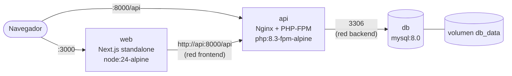
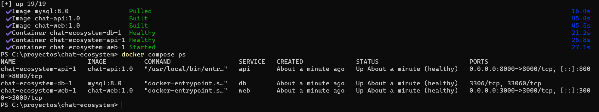
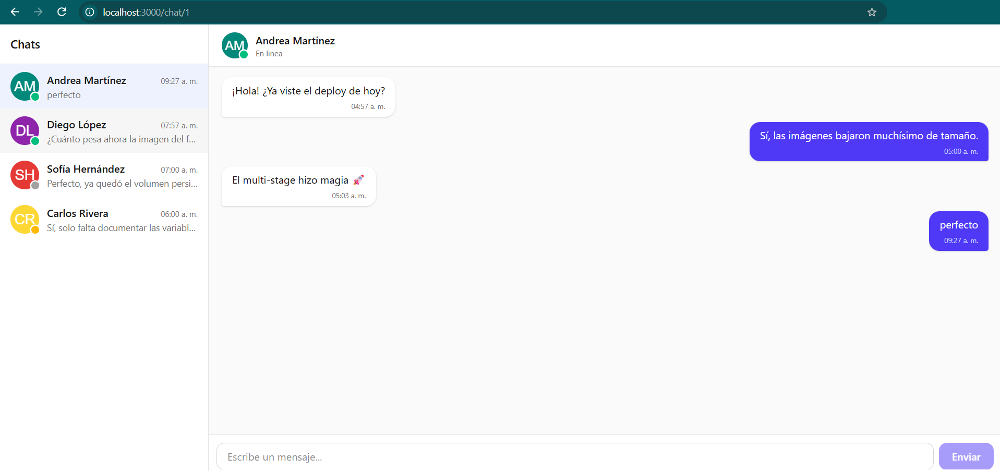

# Chat Ecosystem: imágenes Docker eficientes con builds multi-stage

Ecosistema de producción de una aplicación de chat compuesto por tres servicios orquestados con Docker Compose:

| Servicio | Tecnología | Imagen base |
|---|---|---|
| **web** (Frontend) | Next.js 16.4 (App Router), React 19, Tailwind CSS 4 | `node:24-alpine` |
| **api** (Backend) | Laravel 13, PHP 8.3, PHP-FPM + Nginx | `php:8.3-fpm-alpine` |
| **db** (Base de datos) | MySQL 8.0 | `mysql:8.0` |

Cada imagen se construye con **builds multi-stage** para separar la fase de construcción de la de ejecución, reducir el tamaño final, minimizar la superficie de ataque y aprovechar la caché de capas de Docker. Todo el ecosistema se levanta con un solo comando: `docker compose up`.

---

## Integrantes

| Nombre |
|---|
| Alejandro Campos |
| Miguel Ramos |
| Stephanie Torres |
| Erick Ramos |
| Gerson Sanchez |

---

## Arquitectura de contenedores



- **Red `frontend`**: conecta `web` con `api`.
- **Red `backend`**: conecta `api` con `db`. El contenedor `web` no está en esta red, por lo que no puede alcanzar la base de datos.
- **MySQL no publica el puerto 3306 al host**: solo es accesible desde la API.
- **Orden de arranque**: `db` (healthy) -> `api` (healthy) -> `web`. Compose espera a que cada servicio pase su healthcheck, no solo a que el contenedor inicie.
- **Dos URLs de API**: el navegador usa `NEXT_PUBLIC_API_URL` (`localhost:8000`), mientras que los Server Components usan `API_INTERNAL_URL` (`api:8000`), resuelta por el DNS interno de Docker.

## Estructura del repositorio

```
.
├── docker-compose.yml
├── .env.example
├── compare-images.sh               # Comparación básica vs multi-stage
├── README.md
├── frontend/                       # Next.js (App Router)
│   ├── Dockerfile
│   ├── Dockerfile.basic            # Versión "antes", solo para comparar
│   ├── .dockerignore
│   ├── next.config.ts              # output: "standalone"
│   └── src/
│       ├── app/                    # layout, página inicial y /chat/[id]
│       ├── components/             # lista de chats, ventana de chat, avatar
│       ├── lib/api.ts              # cliente de la API (URL interna vs pública)
│       └── types/chat.ts           # modelos User, Message, Conversation
├── backend/                        # Laravel 13 (API REST)
│   ├── Dockerfile
│   ├── Dockerfile.basic            # Versión "antes", solo para comparar
│   ├── .dockerignore
│   ├── docker/
│   │   ├── entrypoint.sh
│   │   ├── nginx/default.conf
│   │   └── php/zz-production.ini
│   ├── app/Http/Controllers/Api/   # Conversation, Message, User
│   ├── app/Http/Resources/         # JSON con la misma forma que los tipos TS
│   ├── app/Models/                 # User, Conversation, Message
│   ├── database/migrations/
│   ├── database/seeders/
│   └── routes/api.php
└── database/
    └── init/01-charset.sh          # Script de inicialización de MySQL
```

## Endpoints de la API

| Método | Ruta | Respuesta |
|---|---|---|
| GET | `/api/me` | `User` del usuario actual |
| GET | `/api/conversations` | `Conversation[]` ordenadas por actividad reciente |
| GET | `/api/conversations/{id}` | `Conversation` |
| GET | `/api/conversations/{id}/messages` | `Message[]` (últimos 100) |
| POST | `/api/conversations/{id}/messages` | `Message` creado (201). Body: `{ "content": "..." }`, límite de 30 por minuto |
| GET | `/up` | Healthcheck de Laravel |

Los API Resources devuelven exactamente las claves de las interfaces TypeScript del frontend (`avatarUrl`, `chatId`, `isSelf`, etc.), con IDs como `string` y fechas en ISO 8601.

## Requisitos

- Docker Engine 24+ con Docker Compose v2 (BuildKit activo por defecto)

## Cómo ejecutar

1. Clonar el repositorio:
   ```bash
   git clone <url-del-repo>
   cd chat-ecosystem
   ```
2. Crear el archivo de variables y cambiar las contraseñas:
   ```bash
   cp .env.example .env
   ```
3. Generar la llave de Laravel y pegarla en `APP_KEY` dentro de `.env`:
   ```bash
   docker compose run --rm --no-deps --entrypoint php api artisan key:generate --show
   ```
4. Construir y levantar todo el ecosistema:
   ```bash
   docker compose up -d --build
   ```
5. Verificar:
   ```bash
   docker compose ps
   ```
   - Frontend: http://localhost:3000
   - API: http://localhost:8000/api/conversations
   - Healthcheck: http://localhost:8000/up

Al primer arranque la API ejecuta las migraciones y carga conversaciones de ejemplo (el seeder solo inserta datos si la base está vacía).

Para detener: `docker compose down` (los datos se conservan en el volumen). Para borrar también los datos: `docker compose down -v`.

### Fijar dependencias de PHP (`composer.lock`)

Para builds 100% reproducibles, `composer.lock` debe estar versionado. Si el repositorio aún no lo tiene, se genera sin instalar PHP localmente:

```bash
docker run --rm -v "$PWD/backend":/app composer:2 update --no-install --no-scripts
git add backend/composer.lock
```

El `composer.json` fija `config.platform.php = 8.3.0`, así que Composer resuelve versiones compatibles con la imagen de producción aunque se ejecute con otra versión de PHP. El Dockerfile funciona con o sin lockfile, pero con lockfile cada build instala exactamente las mismas versiones.

## Variables de entorno

| Variable | Servicio | Descripción |
|---|---|---|
| `MYSQL_ROOT_PASSWORD` | db | Contraseña de root, solo para administración |
| `MYSQL_DATABASE` | db, api | Base de datos creada al primer arranque |
| `MYSQL_USER` / `MYSQL_PASSWORD` | db, api | Usuario con el que se conecta Laravel (nunca root) |
| `APP_KEY` | api | Llave de cifrado de Laravel |
| `API_PUBLIC_URL` | api | URL pública de la API |
| `FRONTEND_URL` | api | Origen(es) permitido(s) para CORS |
| `RUN_MIGRATIONS` | api | Ejecuta `migrate --force` al iniciar |
| `SEED_DATABASE` | api | Carga datos de ejemplo si la base está vacía |
| `CHAT_SELF_USER_ID` | api | Usuario que representa "yo" en el chat |
| `NEXT_PUBLIC_API_URL` | web (build) | URL de la API para el navegador, se incrusta en el build |
| `API_PORT` / `WEB_PORT` | host | Puertos publicados en el host |

## Decisiones técnicas

### Frontend (Next.js)

- **Tres etapas (`deps`, `builder`, `runner`)**: las dependencias se instalan en una etapa aislada copiando solo `package.json` y el lockfile. Mientras estos no cambien, Docker reutiliza la capa y el build se salta la instalación.
- **`output: "standalone"`**: Next.js genera un `server.js` mínimo y copia solo los módulos que la app realmente usa. La imagen final no contiene `node_modules` completos, devDependencies ni código fuente. `node server.js` es el equivalente optimizado de `next start` para contenedores.
- **`node:24-alpine` en lugar de `node:20-alpine`**: Node 20 llegó a fin de soporte en abril de 2026 y ya no recibe parches de seguridad. Node 24 es la versión LTS activa y cumple el requisito de Next.js 16 (Node 20.9+). Alpine mantiene la imagen base pequeña.
- **`NEXT_PUBLIC_API_URL` como `ARG`**: las variables `NEXT_PUBLIC_*` se incrustan en el JavaScript durante `next build`, por lo que deben existir en la etapa de build.
- **Build independiente de la API**: con Cache Components (activo por defecto en Next.js 16.4), los datos sin caché se cargan dentro de `<Suspense>`. Next.js prerenderiza el "shell" estático y transmite los datos en cada petición, por lo que `next build` no necesita que la API esté levantada.
- **Fuentes del sistema en lugar de Google Fonts**: el build no depende de descargar fuentes de internet, lo que lo hace más rápido y reproducible.
- **Usuario sin privilegios (`nextjs`, UID 1001)**: el proceso no corre como root. `public/` queda como solo lectura y solo `.next` es escribible (caché de ISR).
- **Caché de npm con BuildKit (`--mount=type=cache`)**: acelera reinstalaciones sin guardar la caché dentro de la imagen.
- **`.dockerignore`**: excluye `node_modules`, `.next`, `.git` y `.env`, lo que reduce el contexto de build y evita filtrar secretos.
- **`HEALTHCHECK`** y **telemetría desactivada**.

### Backend (Laravel)

- **PHP 8.3 en lugar de 8.2**: Laravel 13 (versión vigente) requiere PHP 8.3 como mínimo. Se usa `php:8.3-fpm-alpine`, que cumple el requisito de "PHP 8.2+" de la arquitectura.
- **Etapa `vendor` con la misma versión de PHP que producción**: se usa `php:8.3-cli-alpine` con el binario de Composer copiado desde `composer:2`. Así Composer valida dependencias contra el mismo PHP que corre en producción. Composer, git y unzip existen solo en esta etapa; a la imagen final se copia **únicamente la carpeta `vendor/`**.
- **`composer install` antes de copiar el código**: la capa de dependencias queda en caché mientras `composer.lock` no cambie. Se usa `--no-dev` (sin PHPUnit, Faker ni herramientas de desarrollo) y autoload optimizado.
- **Extensiones**: la imagen oficial ya incluye `mbstring`, `openssl`, `tokenizer`, `xml`, `ctype` y `json`. Solo se compilan `pdo_mysql` y `opcache`. Las herramientas de compilación se instalan y eliminan en la misma capa para que no aumenten el tamaño. Un paso del build verifica que las siete extensiones requeridas estén presentes y falla si alguna falta.
- **Nginx + PHP-FPM en el mismo contenedor**: Nginx atiende el puerto 8000 y pasa las peticiones PHP a PHP-FPM por `127.0.0.1:9000`, que nunca se expone. Así el ecosistema se mantiene en tres servicios. La alternativa (Nginx en un contenedor separado) escala mejor de forma independiente, pero requiere compartir `public/` entre contenedores.
- **OPcache con `validate_timestamps=0`**: el código no cambia dentro de un contenedor, así que PHP no revisa archivos en cada petición.
- **Seguridad**: `php.ini-production`, `expose_php=Off`, `server_tokens off`, bloqueo de archivos ocultos en Nginx, CORS restringido al origen del frontend, rate limit en el envío de mensajes, workers de PHP-FPM como `www-data` y solo `storage/` y `bootstrap/cache/` con permisos de escritura. El `.env` nunca entra a la imagen: la configuración llega por variables de entorno.
- **`php artisan optimize` en runtime**: la caché de configuración y rutas se genera al arrancar, porque las variables de entorno llegan desde Compose y no existen durante el build.
- **Seeder sin Faker**: Faker es dependencia de desarrollo y no existe en la imagen de producción, por eso los datos de ejemplo están definidos explícitamente. El seeder es idempotente.
- **Logs a `stderr`**: visibles con `docker compose logs api`.

### Base de datos (MySQL)

- **Imagen oficial `mysql:8.0`** configurada solo con variables de entorno.
- **Volumen nombrado `db_data`** en `/var/lib/mysql`: los datos sobreviven a `docker compose down` y a la recreación de contenedores.
- **Script de inicialización** en `/docker-entrypoint-initdb.d/` (montado como solo lectura): se ejecuta solo la primera vez que se crea el volumen y asegura `utf8mb4` para soportar emojis y acentos en los mensajes. El esquema lo crean las migraciones de Laravel.
- **Sin puerto publicado** y en una red a la que el frontend no tiene acceso.
- **Healthcheck con `mysqladmin ping`**: la API no arranca hasta que MySQL acepta conexiones.

## Validaciones y resultados

Validaciones realizadas durante el desarrollo:

- `next build` con `output: "standalone"` compila sin la API levantada.
- El servidor standalone (`node server.js`) se probó contra una API con la misma forma de respuestas: renderiza la lista de chats, la conversación y el estado de error.
- TypeScript y ESLint sin errores; sintaxis de todos los archivos PHP validada con `php -l`.

| Medición | Tamaño |
|---|---|
| `node_modules` completo del frontend | 489 MB |
| Build standalone que entra a la imagen final | 50 MB |

### Comparación: imágenes básicas vs multi-stage

Para medir el impacto de la optimización, el repositorio incluye las versiones "antes" de cada imagen:

- `frontend/Dockerfile.basic` y `backend/Dockerfile.basic`: representan el enfoque inicial del equipo (una sola etapa, imágenes Debian completas, `COPY . .` antes de instalar dependencias, dependencias de desarrollo incluidas, ejecución como root y servidores de desarrollo). **Solo existen para la comparación, no se usan en producción.**
- `compare-images.sh`: construye las cuatro imágenes y mide tamaño, número de capas, tiempo de build en frío y tiempo de rebuild después de un cambio en el código.

```bash
./compare-images.sh
```

El script imprime la tabla y la guarda en `image-comparison.md`. Ambas versiones usan el mismo `.dockerignore`, así que las diferencias se deben únicamente al diseño de cada Dockerfile.

**Qué demuestra cada columna:**

- **Tamaño**: efecto de Alpine, del build standalone de Next.js, de excluir dependencias de desarrollo y de eliminar herramientas de compilación.
- **Capas**: efecto de agrupar comandos relacionados en un solo `RUN`.
- **Rebuild tras cambio de código**: efecto del orden de las capas. En las imágenes básicas, `COPY . .` va antes de instalar dependencias, por lo que cualquier cambio en el código obliga a reinstalar todo. En las multi-stage, la capa de dependencias se reutiliza desde la caché.

| Imagen | Tag | Tamaño | Capas | Build en frío | Rebuild tras cambio de código |
|---|---|---|---|---|---|
| Frontend basico | `chat-web:basic` | 2907 MB | 12 | 88s | 58s |
| Frontend multi-stage | `chat-web:1.0` | 326 MB | 9 | 41s | 13s |
| Backend basico | `chat-api:basic` | 938 MB | 19 | 43s | 11s |
| Backend multi-stage | `chat-api:1.0` | 184 MB | 23 | 55s | 6s |

_Medido el 2026-10-24 con Docker version 29.9.2, build a82e528._

**Análisis de resultados:**

- **Frontend: 2907 MB -> 326 MB (89% menos).** Se debe a usar Alpine y a copiar solo el build standalone de Next.js, en lugar de los `node_modules` completos y el código fuente.
- **Backend: 938 MB -> 184 MB (80% menos).** Se debe a usar Alpine y a dejar fuera de la imagen final las dependencias de desarrollo, Composer y las herramientas de compilación.
- **Rebuild tras un cambio de código: frontend 58s -> 13s (78% más rápido) y backend 11s -> 6s (45% más rápido).** En las imágenes básicas, `COPY . .` va antes de instalar dependencias, así que cualquier cambio obliga a reinstalar todo. En las multi-stage, la capa de dependencias se reutiliza desde la caché.
- **El build en frío del backend multi-stage es más lento (55s vs 43s).** Es un costo esperado: compila `pdo_mysql` y `opcache` desde código fuente y ejecuta dos etapas. Se paga una sola vez; en el trabajo diario lo que cuenta es el rebuild.
- **El backend multi-stage tiene más capas (23 vs 19).** Cada archivo de configuración (php.ini, Nginx, entrypoint) se copia en su propia capa pequeña, después de la instalación de extensiones, para que un cambio de configuración no obligue a recompilarlas. Más capas no implica más peso: la imagen final pesa 80% menos.

## Evidencias

**Los tres servicios en estado healthy.** En la columna PORTS se ve que `db` no publica puertos al host (solo `3306/tcp`), mientras que `api` y `web` sí (`0.0.0.0:8000` y `0.0.0.0:3000`):



**La aplicación funcionando de punta a punta** (navegador -> API -> MySQL):



## Comandos útiles

```bash
docker compose logs -f api                      # Logs de la API
docker compose exec api php artisan migrate:status
docker compose exec db sh -c 'mysql -u"$MYSQL_USER" -p"$MYSQL_PASSWORD" "$MYSQL_DATABASE"'
docker compose build --no-cache web             # Rebuild completo del frontend
docker compose down -v && docker compose up -d --build   # Reinicio desde cero
```

## Solución de problemas

- **El navegador muestra error de CORS**: revisa que `FRONTEND_URL` coincida exactamente con la URL donde abres el frontend.
- **El frontend llama a una URL vieja de la API**: `NEXT_PUBLIC_API_URL` se incrusta en el build; ejecuta `docker compose build web`.
- **`MissingAppKeyException`**: falta `APP_KEY` en `.env` (paso 3).
- **Cambié las credenciales de MySQL y ya no conecta**: el script de init y las credenciales solo se aplican al crear el volumen; usa `docker compose down -v`.
